# Kalamo Bhala: the complete guide

This guide takes you from the download to writing a chapter with AI help. The numbers in the pictures (**1**, **2**, …)
match the numbered lists under them. The pictures use a made-up demo book, *The Keeper of Gull Rock*.

> [!WARNING]
> Kalamo Bhala is free and provided "as is", without guarantees or warranties of any kind. Bugs can be expected.
> **Keep your own backups of your writing** (see [Backups](#8-backups-and-exports)).

**Contents**
1. [Download and start](#1-download-and-start)
2. [The first start](#2-the-first-start)
3. [Projects](#3-projects)
4. [Writing: the binder and the editor](#4-writing-the-binder-and-the-editor)
5. [Handy tools: split view, find & replace, right-click](#5-handy-tools)
6. [Setting up the AI (OpenRouter)](#6-setting-up-the-ai-openrouter)
7. [Using the AI](#7-using-the-ai)
8. [Backups and exports](#8-backups-and-exports)
9. [Writing a book chapter by chapter](#9-writing-a-book-chapter-by-chapter)
10. [Coming from Raptor Write](#10-coming-from-raptor-write)
11. [Settings](#11-settings)
12. [Where your files are, updating, removing](#12-where-your-files-are-updating-removing)
13. [Troubleshooting](#troubleshooting)

---

## 1. Download and start

Kalamo runs on Windows, Mac and Linux. The pictures in this guide come from Windows; the Mac and Linux versions look
the same inside the browser. **Mac and Linux are new in 0.54:** they pass every automated test on real machines, but
no writer has used them yet.

### Windows

1. Go to the **[Releases page](../../releases/latest)** and click **`Kalamo-Bhala-<version>-Windows.zip`** under *Assets*.
   It is about 14 MB.
2. Open your **Downloads** folder, **right-click** the ZIP and choose **Extract All…**.
   Pick a place you will find again, for example `Documents\Kalamo Bhala`, and click **Extract**.
   *(Do not run it from inside the ZIP without extracting: Windows will not let it work properly.)*
3. In the extracted folder, **double-click `Start Kalamo`**.
4. **If Windows shows "Windows protected your PC":** click **More info**, then **Run anyway**. This appears because Kalamo
   is new and not signed with a paid certificate. It appears only the first time.
5. A **black window** opens. That is Kalamo's engine: **keep it open while you write** (you can minimise it).
   Your browser then opens Kalamo by itself. If it does not, open your browser and go to **http://127.0.0.1:8765**.

Needs Windows 10 or 11 (64-bit). Nothing is installed; Python is included in the `python` folder.

### Mac

1. On the **[Releases page](../../releases/latest)** download **`…-Mac-AppleSilicon.zip`** (M1 and later) or
   **`…-Mac-Intel.zip`** (older Macs; Apple menu → About This Mac shows which you have).
2. Double-click the ZIP and move the **Kalamo Bhala** folder somewhere you will find again, for example Documents.
3. Open the folder and double-click **Start Kalamo.command**.
4. **The first time macOS refuses**, because Kalamo is not signed by Apple: click **Done**, open **System Settings →
   Privacy & Security**, scroll down and click **Open Anyway** next to "Start Kalamo.command" (confirm with your
   password), then double-click it again and click **Open**. Only once.
5. A **Terminal** window opens: keep it open while you write. Your browser opens Kalamo.
6. Kalamo's shortcuts use the **Control** key on a Mac (Ctrl+0 … Ctrl+9 run prompts, because Cmd+1 … Cmd+9 switch
   browser tabs); Cmd+S, Cmd+F and Cmd+Z work as usual.

### Linux

1. On the **[Releases page](../../releases/latest)** download **`…-Linux-x64.tar.gz`** (most PCs) or
   **`…-Linux-ARM64.tar.gz`** (ARM, for example a Raspberry Pi 4/5 with a 64-bit system).
2. Unpack it: `tar -xzf Kalamo-Bhala-<version>-Linux-x64.tar.gz` (or "Extract Here" in your file manager).
3. In a terminal: `cd "Kalamo Bhala <version>"` and `./start-kalamo.sh`. Keep the terminal open while you write.
4. Needs a desktop Linux from about 2018 or later (not Alpine).

**Which browser?** Kalamo opens in your own default browser. Chrome, Edge, Brave, Vivaldi and Opera are tested the
most; Safari and Firefox should work but are not tested yet.

## 2. The first start

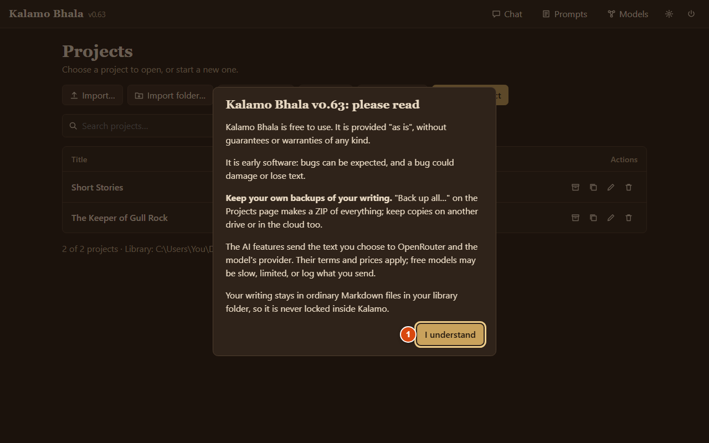

Kalamo first shows a short notice. Read it and click **I understand** (**1**). It appears once (and again after an
update).

**The setup wizard** then takes you through five short steps (you can also run it later: Settings → *Run the setup
wizard again…*):

1. **Welcome:** where your writing is kept (the *library folder*, normally `Documents\MyWritings`).
2. **Raptor Write backups:** *Yes* or *No*.

   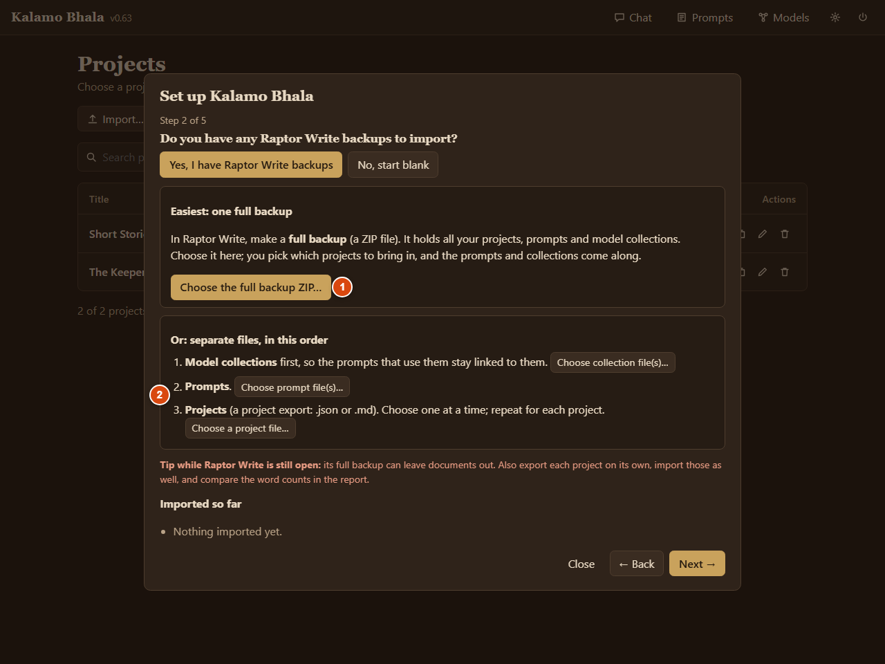

   - **Easiest (1):** choose your Raptor Write **full backup** ZIP. You tick the projects you want; their prompts and
     model collections come along by themselves, and every document is checked word by word.
   - **Or separate files (2)**, in this order: **model collections** first (so the prompts stay linked to them), then
     **prompts**, then each **project export** (.json or .md), one at a time.
   - **Tip:** Raptor Write's full backup can leave documents out. While Raptor Write is still open, also export each
     project on its own, import those too, and compare the word counts in the report.
   - *No* starts blank and can make your first project for you.
3. **Your OpenRouter key** (for the AI features):

   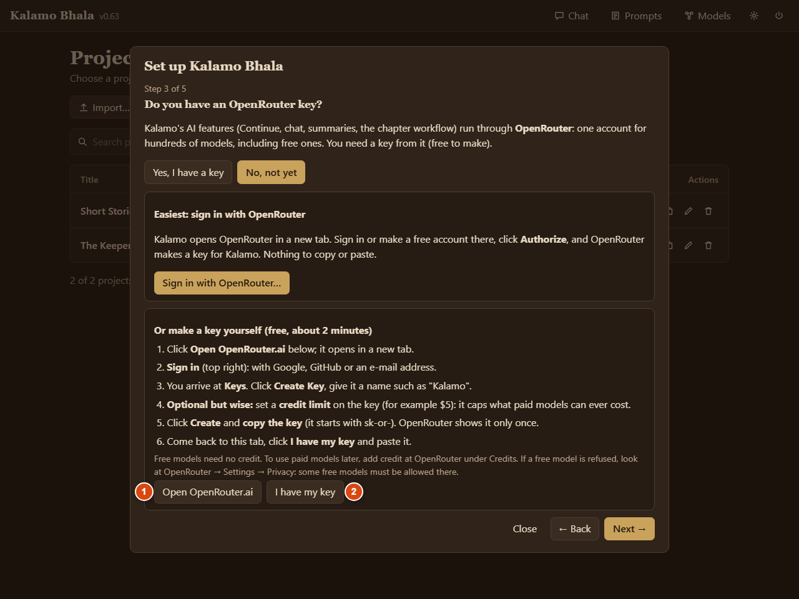

   - *Yes, I have a key*: paste it and click **Save and test the key**.
   - *No, not yet*: the easiest way is **Sign in with OpenRouter…**: OpenRouter opens in a new tab; sign in (or make a
     free account), click **Authorize**, and OpenRouter makes a key for Kalamo. Nothing to copy or paste.
   - Or make a key yourself with the six steps on screen: **Open OpenRouter.ai** (**1**) opens the key page in a new tab;
     sign in, **Create Key**, copy it, come back and click **I have my key** (**2**). More detail: [section 6](#6-setting-up-the-ai-openrouter).
   - You can also skip this and add the key later under **Settings → API keys**.
4. **Your defaults:** the standard prompts and model collections, the starting model (`openrouter/free`), and any
   imported models that no longer exist on OpenRouter (choose another model for those). Here you also choose what
   Kalamo opens when it starts: **the project that was open last time** (normal), the Projects page, or a new project.
5. **All set:** **Start writing** opens your (first) project.

## 3. Projects

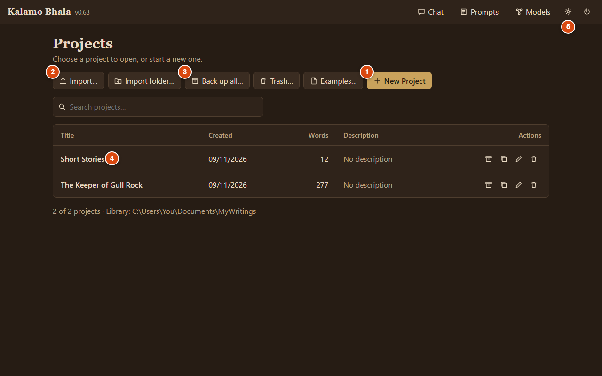

1. **New Project:** start a new book, report or collection. **Examples…** adds a ready-made example project.
2. **Import…:** bring in a Raptor Write backup, a Markdown file, or a Kalamo backup (see [section 10](#10-coming-from-raptor-write)).
   **Import folder…** next to it turns a folder of `.md` / `.txt` files into a project.
3. **Back up all…:** one ZIP of all your projects (see [section 8](#8-backups-and-exports)).
4. **A project:** click its name to open it. The small icons on the right back it up, copy it, rename it or delete it
   (deleted projects go to the trash, not off the disk: **Trash…** shows them and can restore them).
5. **Settings** (the gear icon): library folder, colours, text size, API keys and more ([section 11](#11-settings)).

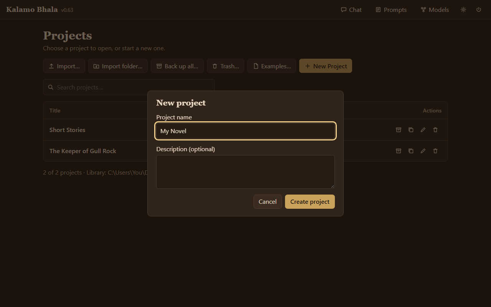

**New Project** asks for a name (and an optional description). Click **Create project** and the project opens.

**Example projects.** A new install starts with four example projects, so there is something to look around in:

| Example | What it shows |
| --- | --- |
| **School, Grade 8** | seven subjects with worksheets; a project folder with a *Research* folder inside |
| **University, BA Psychology Year 1** | lecture notes and assignments for six modules; a group project |
| **Novel, *Salt and Signal*** | chapters with scene breaks, characters, a map, a timeline, a story arc |
| **Work, *Harbourside Logistics*** | a report with figures and a chart, meeting notes, a letter, a memo, a proposal |

Each starts with a *Start here* document. Change them or delete them: deleted examples do not come back, and
**Examples…** adds one again whenever you like.

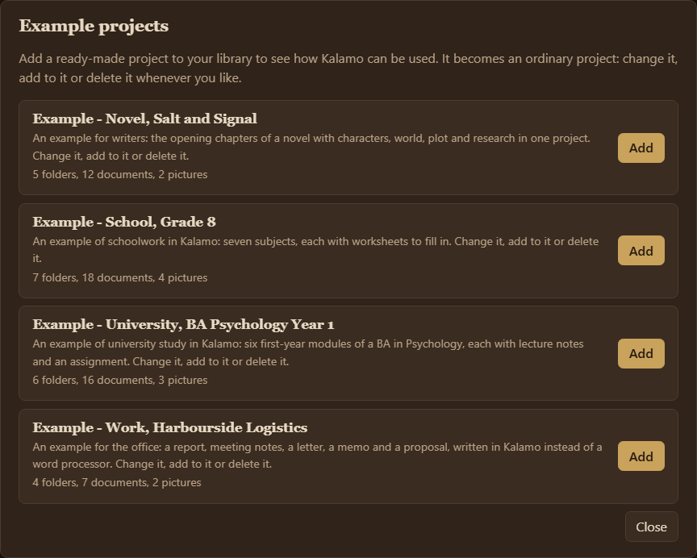

**Examples…** lists the four examples with what is in them; **Add** puts a fresh copy in your library (a second copy
gets "(2)" after its name).

When you start Kalamo again it opens **the project you had open last time** (change this in Settings → *Start Kalamo with*).

## 4. Writing: the binder and the editor

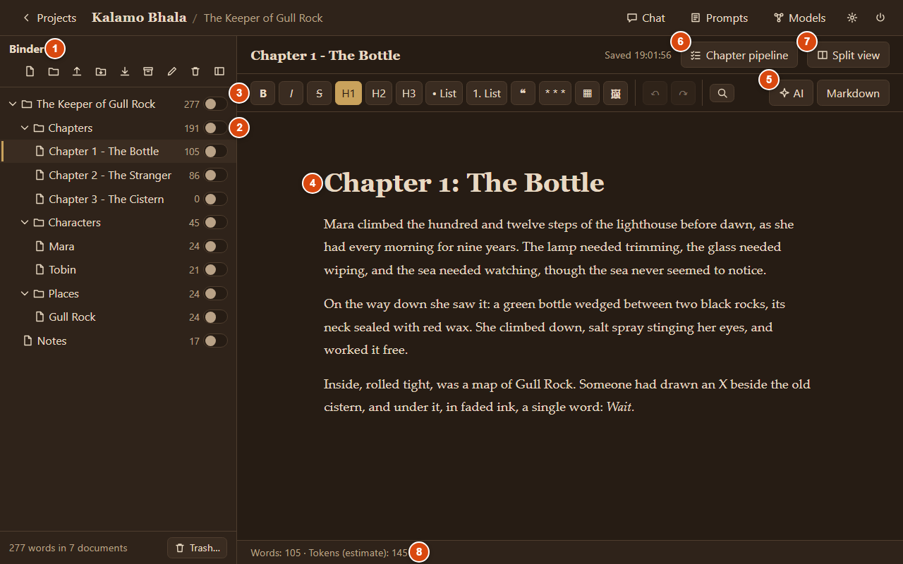

1. **The binder toolbar:** new document, new folder, import files, import a folder, export, back up this project,
   rename (F2), delete, hide the binder. **Drag** documents and folders to move or reorder them. Deleted documents go
   to the project's trash: **Trash…** at the bottom of the binder shows them, restores them (never over another
   document) or deletes them for good.
2. **The switch** on each row decides which documents are sent to an AI prompt as background (the
   `{{selected_documents}}` of a prompt). A folder's switch sets everything inside it. The number is the word count.
3. **Formatting:** bold, italics, strikethrough, headings, lists, quote, scene break, **table (▦)**, **picture (🖼)**,
   undo/redo, find (magnifier).
   Keys: **Ctrl+B**, **Ctrl+I**, **Ctrl+Z** (undo), **Ctrl+Y** (redo), **Ctrl+S** (save now).
   Typing `# `, `- ` or `1. ` at the start of a line formats it too.
4. **Your text.** It is saved by itself a couple of seconds after you stop typing ("Saved" at the top), and a safety
   copy is kept every few minutes. If a save ever fails, Kalamo tells you.
5. **AI:** the list of prompts and commands (the same as typing `/`, see [section 7](#7-using-the-ai)).
6. **Chapter pipeline:** the chapter-by-chapter workflow ([section 9](#9-writing-a-book-chapter-by-chapter)).
7. **Split view:** see another document while you write.
8. **Word count** of this document (and an estimate of its size for the AI).

**Renaming:** click the document's **name above the editor**, type the new name and press **Enter** (**Escape**
cancels). In the binder, select a document or folder and press **F2**, click the pencil, or right-click it →
**Rename…**.

**Tables**

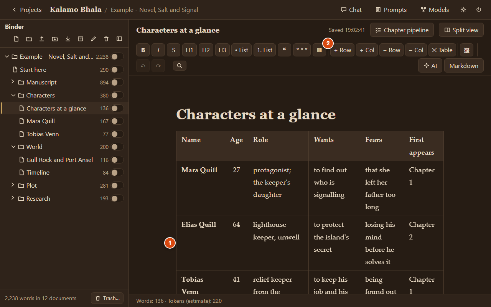

1. **A table** in your text. Click in a cell to type; **Tab** moves to the next cell.
2. **The table buttons.** **▦** inserts a new table with a header row. While the cursor is in a table, buttons appear
   to add a row (**+ Row**) or a column (**+ Col**), or to delete a row, a column or the whole table.

Tables are saved as ordinary Markdown tables, so other Markdown programs show them too.

**Pictures**

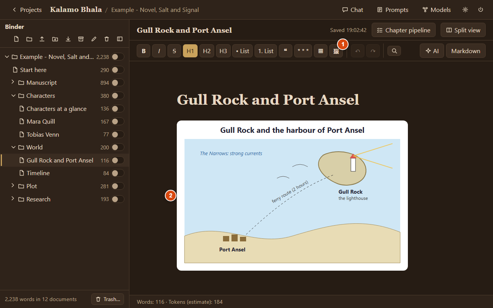

1. **The 🖼 button** adds a picture (PNG, JPEG, GIF, WebP or SVG) at the cursor.
2. **The picture** in your text. Kalamo copies it into the project's *images* folder (not shown in the binder) and the
   document keeps an ordinary Markdown link to it. Pictures are in your backups, and in a ZIP export of a whole project.

**New here.** Right-click a folder or the project name → **New document here…** or **New folder here…** to add it
right inside that folder.

**Markdown** (top right) shows the document exactly as it is stored on disk. Your files are ordinary `.md` files: you
can also open them in Notepad, Word or Obsidian, and Kalamo notices when they change outside it.

## 5. Handy tools

**Split view**

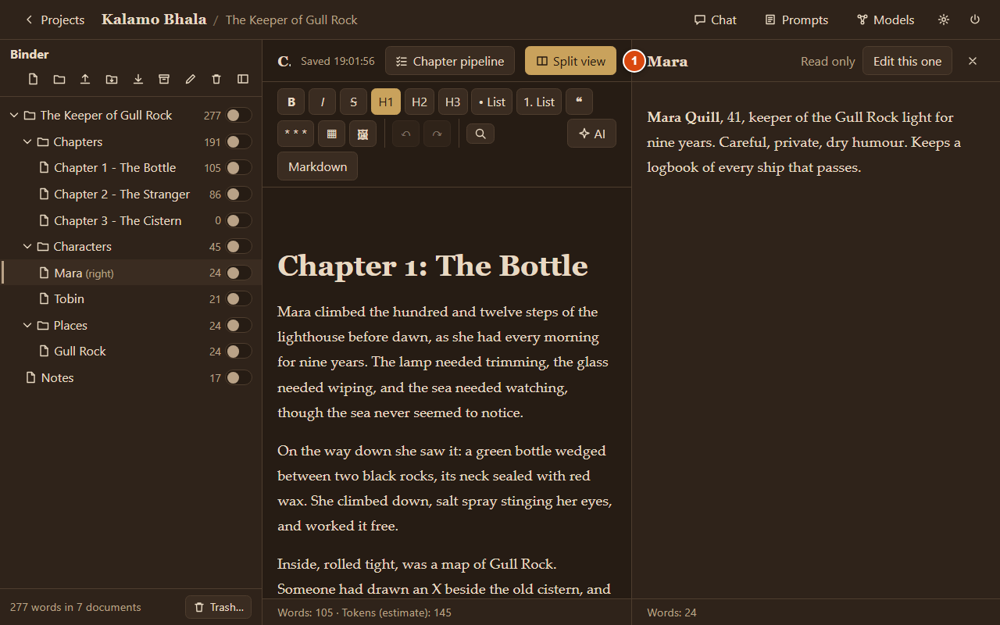

Click **Split view**, then click any document in the binder: it opens on the right, read only (**1**), while your
chapter stays on the left. **Edit this one** swaps the two. Click **Split view** again to close it.

**Find and replace**

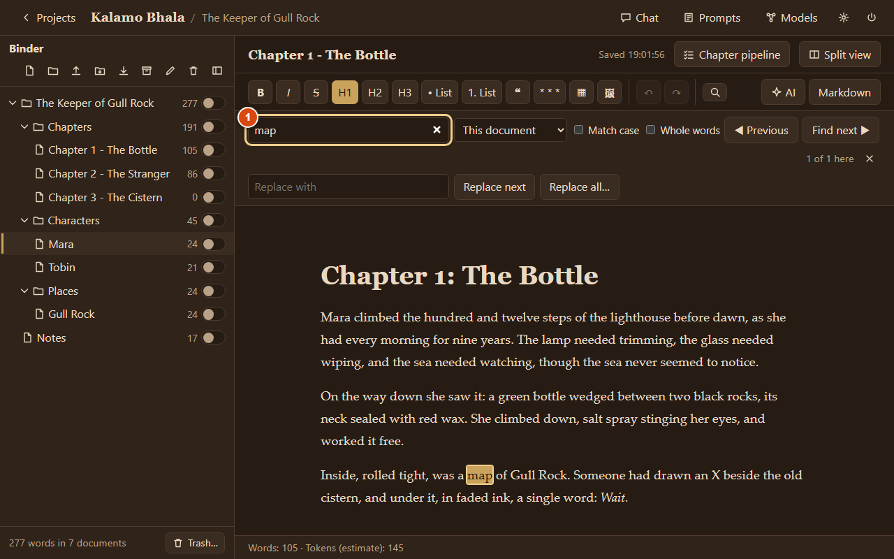

Press **Ctrl+F** (or the magnifier). The bar (**1**) finds in **this document**, the **folder** or the **whole
project**; **Ctrl+H** jumps to *Replace*. *Replace all* asks first and keeps safety copies of every changed document.

**Right-click in the binder**

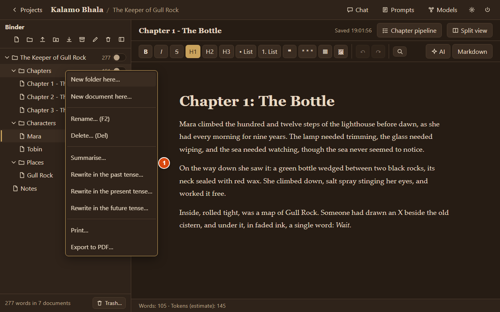

Right-click a document, a folder or the project name (**1**) to add a document or folder inside it, rename or delete
it, **summarise** it or **rewrite it in the past, present or future tense** with AI, or **Print…** / **Export to
PDF…** it (see [section 8](#8-backups-and-exports)).

## 6. Setting up the AI (OpenRouter)

Kalamo's AI features use **OpenRouter**, one account that gives access to hundreds of models (Claude, GPT, Gemini,
Grok, Mistral, DeepSeek and many free ones).

**The easy way:** open **Settings** (the gear) → **API keys** and click **Sign in with OpenRouter…**. OpenRouter opens
in a new tab: sign in (or sign up, free), click **Authorize**, and OpenRouter makes a key called *Kalamo Bhala*, which
Kalamo saves for you. Come back to Kalamo; the box closes by itself.

**Or by hand:**

1. Go to **[openrouter.ai](https://openrouter.ai)** and sign up (free).
2. Open **Keys** (in your account menu) and click **Create Key**. Give it a name such as *Kalamo*.
3. Copy the key (it starts with `sk-or-`).
4. In Kalamo, open **Settings → API keys** → **Paste a key…** on the OpenRouter row, paste it and click **Save key**.
   **Test** checks it.

Either way: the key is kept in Kalamo's settings file on your PC only, never in your writing, backups or exports.
**Tip:** set a **credit limit** on the key at openrouter.ai → Keys (for example $5): it is the best safety net against
surprises. To use paid models later, add credit at OpenRouter (**Credits**). The free models need no credit.

**Other providers (optional):** Settings → API keys also takes keys for **OpenAI**, **Anthropic (Claude)**, **Google
(Gemini)** and **xAI (Grok)**. With such a key you can choose that provider when you add a model to a collection, and
pay it directly instead of through OpenRouter. The cost Kalamo shows for these is an estimate from the tokens used.

**Model collections**

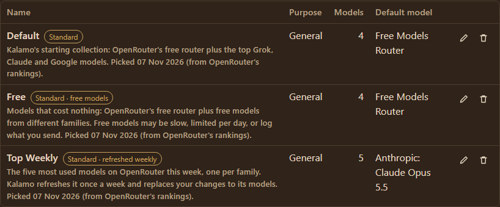

Kalamo starts you with three collections:
- **Default:** `openrouter/free` (OpenRouter picks a free model) plus the top Grok, Claude and Google models.
- **Free:** models that cost nothing.
- **Top Weekly:** the five most used models on OpenRouter this week, one per maker. Kalamo refreshes it every week.

Make your own with **New collection** (type to search OpenRouter's models; prices and limits fill in by themselves).

> [!NOTE]
> Every AI feature **starts on `openrouter/free`**, so you can try everything without paying. Free models can be slow
> or limited per day, and some providers keep what is sent to them. For your real manuscript you may prefer a paid
> model: choose one in the model box of the feature you use.

## 7. Using the AI

**The "/" list**

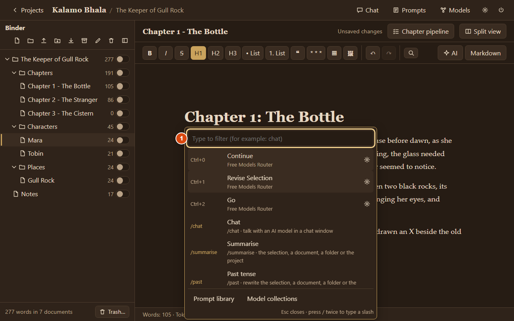

In your text, type **`/`** at the start of a line (or after a space), or click **AI**. Type to filter (**1**), use the
arrow keys and **Enter**. The gear next to a prompt opens its settings for this run: **Input** (boxes only for the
variables the prompt uses), **Prompt**, **Model** and **Preview** (exactly what is sent, and the estimated cost).
On the Model tab, the temperature and length come from the prompt or its collection; an **empty box is not sent**, and
the model then uses its own default (temperature usually 1.0, length up to the model's limit).

- **Continue** (**Ctrl+0**) writes on from the cursor in your voice (a few paragraphs). Notes in `[square brackets]`
  in your text are read as instructions and not copied. In the middle of a chapter it also reads the text after the
  cursor, so the new part leads into it.
- **Revise Selection** (**Ctrl+1**) rewrites the selected text the way you ask (or, with no instructions, tightens it
  and fixes the grammar without adding anything).
- **Go** (**Ctrl+2**) sends your background documents and the text so far, with no instruction: end your text with
  a request (for example `[Give me five names for the boat]`) and Go answers it.
- Select some text and the prompts that use it appear in a small bar under the selection (Settings can switch this off).
- Your own prompts get **Ctrl+3** and up; you can choose each prompt's key in its settings. **Ctrl+\\** runs the last prompt again.

**The reply**

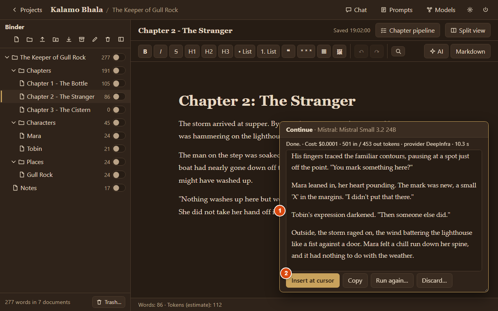

The reply streams into its own window (**1**); **nothing changes in your document** until you click **Insert at cursor**
(**2**) (or *Replace selection*). Kalamo saves a safety copy first, and **Ctrl+Z** takes the insert out again.
The top line shows the model, the cost, and whether the provider keeps billing if you press **Stop**.
Drag the window by its title; resize it at its corner.

**Your prompts**

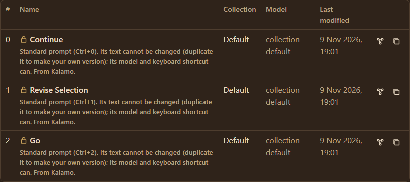

**Prompts** (top bar) holds your prompt library. Prompts use variables such as `{{before}}` (the text before the cursor),
`{{selected_text}}`, `{{selected_documents}}` (the switched-on documents) and `{{user_input}}` (asked when you run it).
The three standard prompts cannot be edited (duplicate one to make your own), but **Model settings** chooses their model.

**Chat**

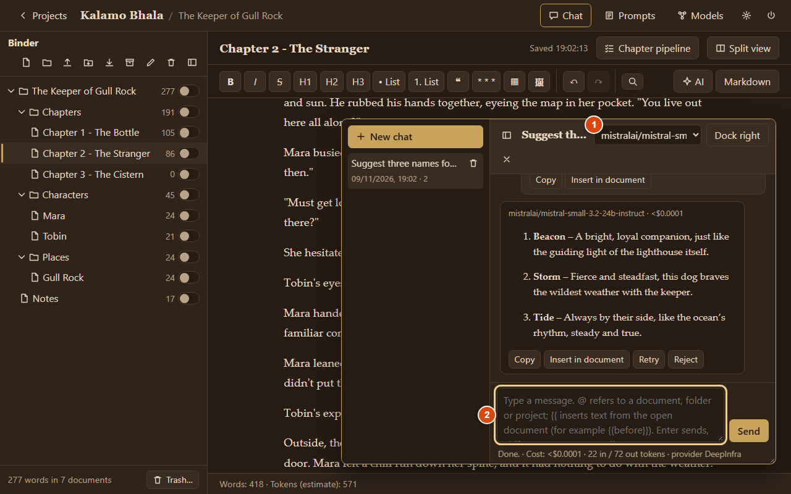

**Chat** (top bar, or type `/chat`) talks with any model (**1**). In the message box (**2**), type **`@`** to include a
document, folder or project, or **`{{`** to include text from the open document. **Insert in document** puts a reply in
your text. Chats are saved by themselves; **Dock right** puts the chat beside your text.

**Summaries and tense**

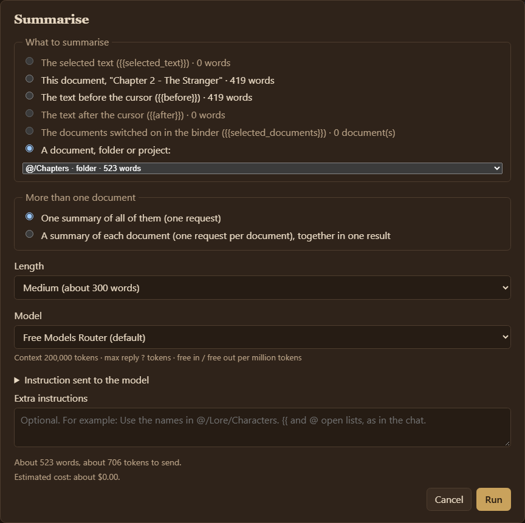

`/summarise` (or right-click → **Summarise…**) summarises the selection, a document, a folder or the whole project.
`/past`, `/present` and `/future` rewrite text in that tense. You see the result first; save it as a new document,
insert it, or (for tense) replace the original. A safety copy is always made first.

## 8. Backups and exports

- **Back up all…** (Projects page) makes one ZIP of every project, your prompts and collections, in
  `Documents\KalamoBackups`. The archive icon in the binder backs up one project. **Copy these ZIPs to another drive
  or the cloud regularly.**
- **Restore:** Projects page → **Import…** → choose a Kalamo backup ZIP. Restoring never overwrites; it adds
  "(restored)" copies.

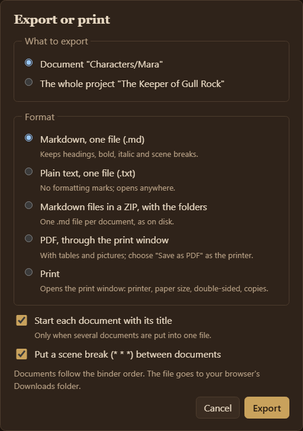

**Export** (binder toolbar) saves a document, a folder or the whole project as one Markdown file, one plain-text file,
or a ZIP of the `.md` files, in binder order.

**PDF and printing.** In the same dialog, **PDF** and **Print** open your browser's print window with the document,
folder or project laid out as pages, tables and pictures included. To make a PDF, choose **Save as PDF** as the
printer. You can also right-click in the binder → **Print…** or **Export to PDF…**, or press **Ctrl+P** in the editor.

Kalamo also keeps automatic safety copies of documents before any AI change, in a hidden `.kalamo\safety` folder
inside each project.

## 9. Writing a book chapter by chapter

This is the Future Fiction Academy's *Narrative Physics Engine* workflow. You build a **worksheet** (the story bible)
once, then write each chapter in steps. **You stay in control: nothing becomes part of your book until you accept it.**

**Step 1: the worksheet** (`/worksheet`, or **Worksheet…** in the chapter pipeline)

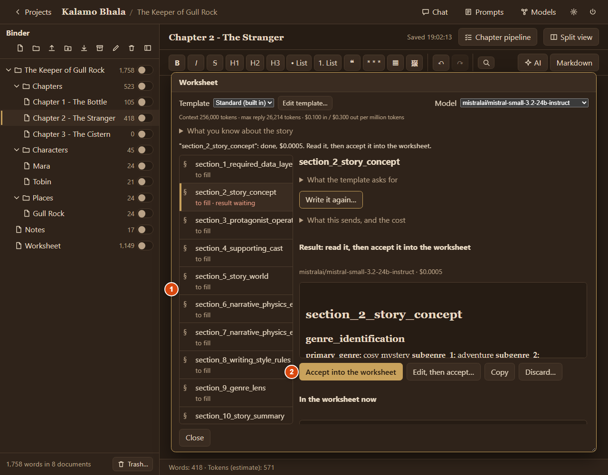

1. Open **What you know about the story** and write everything you already know: genre, characters, plot, ending,
   rules. Set the number of chapters. **Save.**
2. Click **Create it from the template**: a *Worksheet* document with 18 sections appears in the binder.
3. Choose a section (**1**), click **Write this section**, read the result, then **Accept into the worksheet** (**2**),
   or **Edit, then accept…**, or **Discard**. Go through the sections in order; each one builds on the earlier ones.
4. **Edit template…** changes the sections, for this book or for all books.

**Step 2: the chapter pipeline** (**Chapter pipeline** above the editor, or `/chapter`)

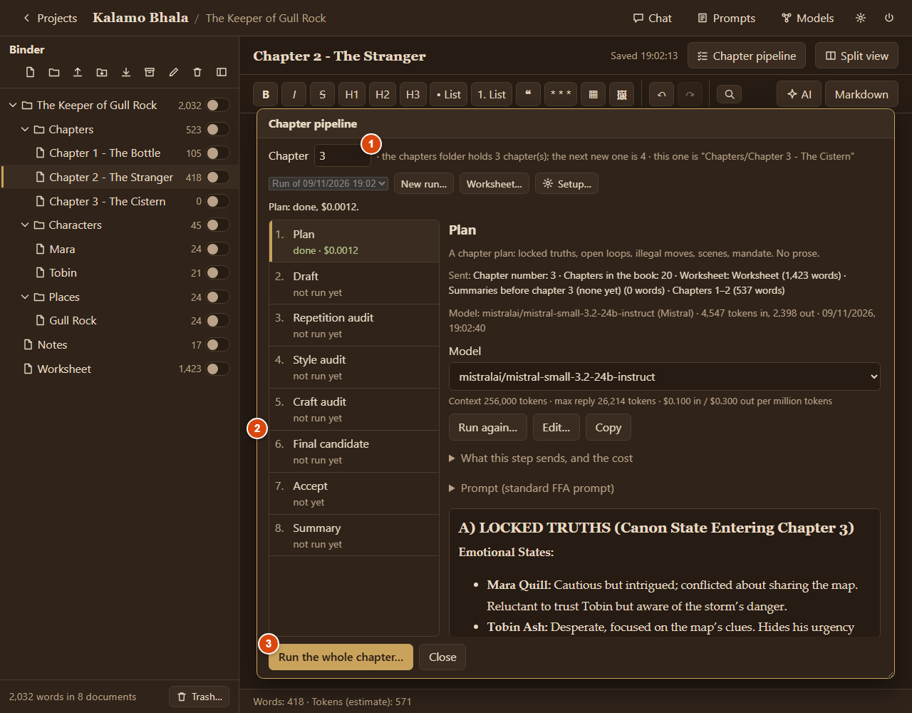

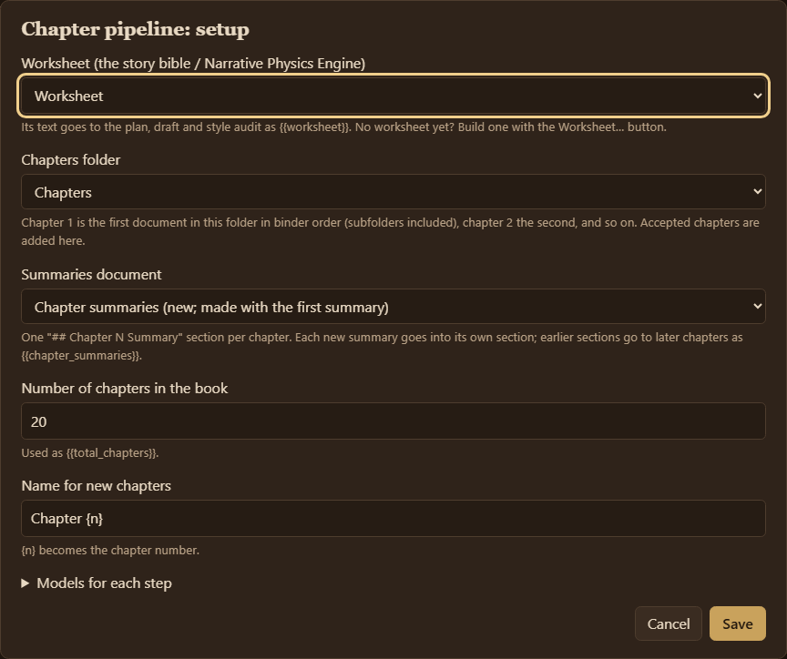

1. **Setup…** (once per book): the worksheet document, the **chapters folder** (chapter 1 is the first document in it),
   the summaries document, the number of chapters, and a model for each step.
2. Choose the **chapter** (**1**). The steps (**2**): **Plan → Draft → Repetition, Style and Craft audits → Final
   candidate → Accept → Summary**.
3. Run the steps one by one (**Run**), or click **Run the whole chapter…** (**3**): give a budget and a limit on the
   number of requests. Kalamo checks the cost before every request and stops if it could go over, and it stops at the
   final candidate for you to read.
4. **What this step sends, and the cost** shows the full prompt before you pay for anything. You can **Edit** any
   step's output; steps that used it then show *out of date*.
5. **Accept** puts the final candidate into your chapters folder; the **Summary** then goes into the summaries document,
   ready for the next chapter.

## 10. Coming from Raptor Write

1. In Raptor Write, make a **full backup** (a ZIP), or export single projects.
2. In Kalamo: Projects page → **Import…** → choose the file. You see what is inside; tick the projects you want and click
   **Import N projects**. Kalamo checks every word against the original and shows a report.
3. Your Raptor Write **prompts and model collections** come along: **Prompts** → **Import from Raptor Write**.
   Raptor Write's Continue, Revise Selection and Go become Kalamo's Ctrl+0, Ctrl+1 and Ctrl+2.

## 11. Settings

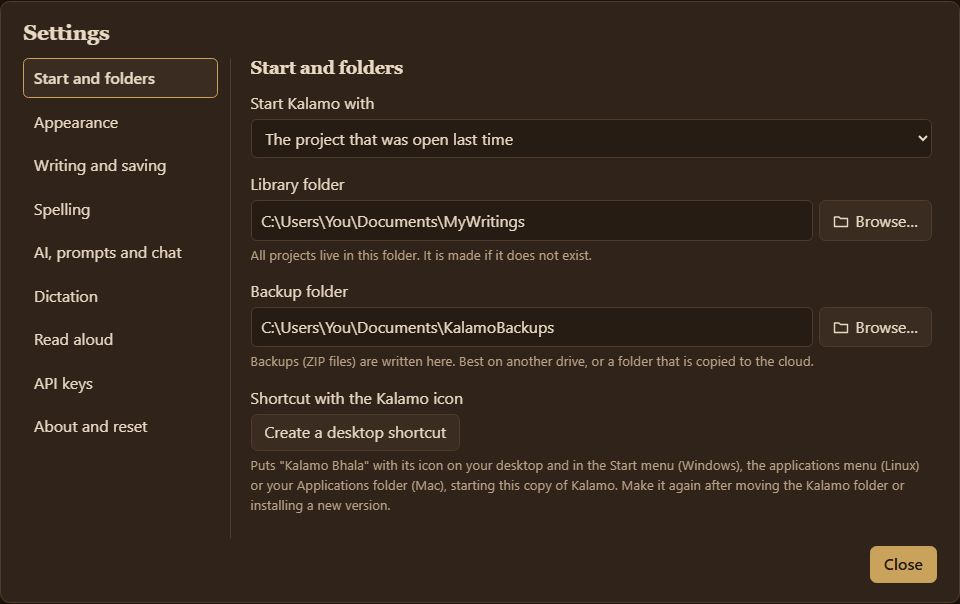

The gear (top right) opens Settings: the groups are on the left, their settings on the right. There is no Save button:
a change is saved at once.

- **Start and folders:** what Kalamo opens with, the **library folder** and the **backup folder**. **Browse…** picks a
  folder; you can also type a path.
- **Appearance:** the **colour scheme** (Walnut, Sand, Dark, Light, Follow the system, High contrast, Forest, Lavender,
  Sky) and the **interface size** (up to 200%).
- **Writing and saving:** autosave and safety-copy timing.
- **Spelling:** spell check on or off, and its language.
- **AI, prompts and chat:** the order of the `/` list, the prompts shown under a selection, the chat's default model
  and memory.
- **API keys:** OpenRouter (sign in or paste a key) and, if you want them, OpenAI, Anthropic, Google and xAI.
- **About and reset:** the version, the setup wizard again, and **Reset to defaults** (your folders, keys, prompts
  and writing are kept).

> [!TIP]
> **Spell check in another language:** your browser needs that language's dictionary once. In Settings → Spelling,
> **Show me** opens your browser's language settings (Chrome, Edge, Brave, Vivaldi, Opera), or explains where they are (Firefox, Safari): add the language and switch on spell check for it.

## 12. Where your files are, updating, removing

| What | Where |
| --- | --- |
| Your writing | `Documents/MyWritings` in your home folder (one folder per project; change it in Settings) |
| Backups | `Documents/KalamoBackups` |
| Settings and your API keys | Windows: `%APPDATA%\KalamoBhala\settings.env`; Mac: `~/Library/Application Support/KalamoBhala/settings.env`; Linux: `~/.config/KalamoBhala/settings.env` |
| The app | the folder you unpacked |

- **Updates (from 0.53):** once a week Kalamo checks GitHub for a new version. It downloads one small file; nothing
  about you or your writing is sent (GitHub sees your internet address, as with any website, and counts the download).
  When a new version is out, a pop-up says what is new:
  - **Download and install** (Windows and Mac; on Linux the pop-up opens the download page for now): Kalamo downloads
    the new version, checks it (SHA-256) and unzips it next to your current
    folder, then offers **Restart now**: the same browser tab reopens in the new version. At the next start Kalamo offers
    to delete the old version's folder (only if it holds nothing but Kalamo's own files).
  - **Remind me next week:** no pop-up for a week. The **New version** button at the top keeps it within reach.
  - Switch the weekly check off, or **Check now**, in Settings → *About and reset*.
- **Update by hand** (and from 0.51 or 0.52): click the power button (Quit), unpack the new version, start it, and
  delete the old folder. Nothing else changes.
- **Remove:** delete the app folder. Your writing stays in `Documents/MyWritings`.
- **Stop Kalamo:** the power button at the top right (**Quit**): it saves, stops Kalamo and closes the tab. Closing
  the black (Terminal) window also stops it.

## Troubleshooting

| Problem | What to do |
| --- | --- |
| "Windows protected your PC" | Click **More info** → **Run anyway**. |
| Mac: "Start Kalamo.command cannot be opened" | System Settings → Privacy & Security → **Open Anyway** (once). See [Mac](#mac). |
| Linux: "Permission denied" for start-kalamo.sh | Unpack with `tar -xzf` (keeps the permissions), or run `chmod +x start-kalamo.sh` once. |
| My antivirus complains | Kalamo is new and unsigned; some antivirus programs are wary of new files. You can check the download against the SHA-256 file on the Releases page. |
| The browser did not open | Open your browser and go to **http://127.0.0.1:8765**. |
| "Cannot reach Kalamo Bhala" in the browser | The black (Terminal) window was closed. Start Kalamo again. |
| It opened on another address (8766…) | Another program used port 8765; Kalamo took the next free one. That is fine. |
| The AI says the key is missing or wrong | **Settings → API keys**: **Sign in with OpenRouter…** or **Paste a key…**, then **Test**. Check the key at openrouter.ai → Keys. |
| A free model fails or is very slow | Free models are limited and busy at times. Try again later, or choose another model. At openrouter.ai → Settings → Privacy, free models may need to be allowed. |
| "Insufficient credits" | Add credit at openrouter.ai → Credits, or use a free model. |
| A document changed outside Kalamo | Kalamo reloads it, or (if you had unsaved changes) asks which version to keep. |
| I lost text | Look in the project's `.kalamo\safety` and `.kalamo\recovery` folders (show hidden items in File Explorer), and in your backups. |

Still stuck? Open an [issue](../../issues): what you did, what you expected, what happened, and the Kalamo version
(top left). Please never attach your private writing.
