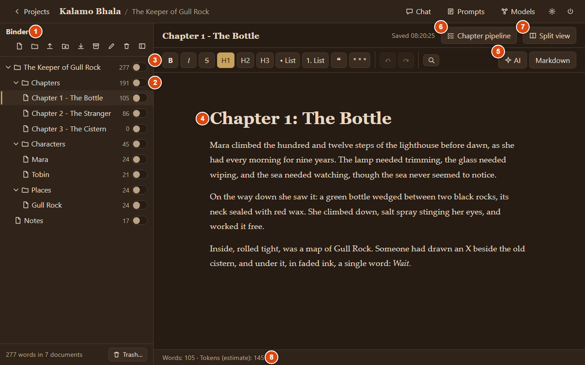
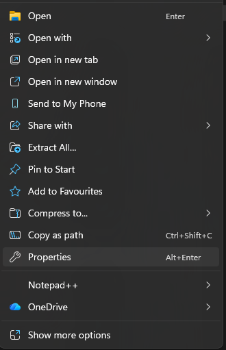
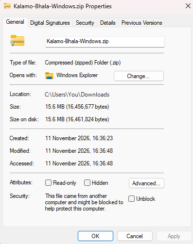

# Kalamo Bhala - v0.70

**A free writing app for long-form work** (novels, books, reports, articles) that runs on your own computer (Windows, Mac or Linux) and opens in your web browser. Your writing is kept as ordinary Markdown files in a folder you choose, so it is never locked in. AI help (continue, revise, chat, summaries, pictures, voice, a chapter-by-chapter workflow) works with your own API key, including free models.



> [!WARNING]
> **Kalamo Bhala is free and provided "as is", without guarantees or warranties of any kind.** It is early software: bugs can be expected, and a bug could damage or lose text. **Keep your own backups of your writing.**
> The AI features send only the text you choose to your chosen AI service; their terms and prices apply.

## Get started: step by step

You don't need to know anything about GitHub. This page is just where Kalamo is kept. Follow the steps for your computer.

### Windows 10 or 11

**Step 1. Download.** Click this link: **[⬇ Download Kalamo Bhala for Windows](../../releases/latest/download/Kalamo-Bhala-Windows.zip)** (about 16 MB). Your browser saves the file in your **Downloads** folder.

**Step 2. Find the file.** Open **File Explorer** (the yellow folder on the taskbar) and click **Downloads** on the left. The file is called `Kalamo-Bhala-Windows.zip` (or `Kalamo-Bhala-0.70-Windows.zip`). (In Chrome or Edge you can also click the download arrow at the top right and then the folder icon.)

**Step 3. Unblock the ZIP before unpacking (recommended on Windows 11).** Right-click the ZIP file → **Properties** → at the bottom next to *Security*, tick **Unblock** → click **OK**. *(Windows marks downloaded ZIP files as coming from the internet; unblocking first clears that tag from the files inside.)*

 

**Step 4. Unpack it.** Right-click the ZIP → **Extract All…** → **Browse…** and choose your **Documents** folder → **Extract**. Windows makes a folder called `Kalamo Bhala 0.70` and opens it. Don't start Kalamo from inside the ZIP without unpacking it: it will not work properly.

**Step 5. Start Kalamo.** In the new folder, double-click **Start Kalamo**.

**Step 6. Only the first time, if Windows blocks `Start Kalamo`:**
- **If you see "Windows protected your PC" (SmartScreen):** click **More info**, then **Run anyway**. *(Kalamo is not signed with a paid certificate, so Windows warns you once.)*
- **If you see "Smart App Control blocked…" (no "Run anyway" button):**
  1. Make sure you ticked **Unblock** on the ZIP *before* unpacking (Step 3). If you unpacked it first, delete the unpacked folder, Unblock the ZIP, and Extract All again.
  2. If Smart App Control still blocks `.bat` script files on your PC, start Kalamo directly with the signed Python inside the folder: open the `Kalamo Bhala 0.70` folder, right-click empty space inside the folder → **Open in Terminal**, and run:
     ```powershell
     .\python\python.exe -m kalamo
     ```

**Step 7. Keep the black window open.** A black window (the console) opens; it *is* Kalamo running. Leave it open while you write; you can minimise it. Your web browser then opens Kalamo by itself. (If it doesn't, open your browser and go to `http://127.0.0.1:8765/`.)

**Step 8. Read the notice, then choose: guided setup or not.** Click **I understand**. Kalamo asks whether you want a short guided setup (about 5 minutes): it explains everything, including how to connect a free AI account. Choose **No thanks** if you prefer to look around yourself; the setup is in Settings whenever you want it.

**Next time:** open the folder and double-click **Start Kalamo** again, or use **Settings → Start and folders → Create a desktop shortcut** for an icon on your desktop and Start menu.
**To stop Kalamo:** click the power button at the top right in Kalamo (or close the black window).

<details>
<summary><b>Mac</b> (click to open the steps)</summary>

**Step 1. Download.** Apple Silicon (M1 and later): **[⬇ Mac (Apple Silicon)](../../releases/latest/download/Kalamo-Bhala-Mac-AppleSilicon.zip)**.
Intel Mac: **[⬇ Mac (Intel)](../../releases/latest/download/Kalamo-Bhala-Mac-Intel.zip)**. Not sure which? Apple menu → **About This Mac**: "Chip Apple M…" is Apple Silicon, "Processor Intel…" is Intel. *(Note: Apple Silicon passes automated CI tests; Intel Mac has no CI machine.)*

**Step 2. Unpack it.** Open **Downloads** in Finder and double-click the ZIP. Drag the new folder to **Documents**.

**Step 3. Start Kalamo.** Double-click **Start Kalamo.command**.

**Step 4. Only the first time.** macOS refuses because the download is not signed by Apple: click **Done**. Open **System Settings → Privacy & Security**, scroll down and click **Open Anyway** next to "Start Kalamo.command". Double-click it again and click **Open**.

**Step 5. Keep the Terminal window open.** Your browser opens Kalamo. Then continue at Windows step 8.

</details>

<details>
<summary><b>Linux</b> (click to open the steps)</summary>

**Step 1. Download.** Most PCs: **[⬇ Linux x64](../../releases/latest/download/Kalamo-Bhala-Linux-x64.tar.gz)**; ARM (for example a Raspberry Pi 4/5, 64-bit): **[⬇ Linux ARM64](../../releases/latest/download/Kalamo-Bhala-Linux-ARM64.tar.gz)**.

**Step 2. Unpack it.** Right-click → **Extract Here**, or in a terminal: `tar -xzf Kalamo-Bhala-Linux-x64.tar.gz`.

**Step 3. Start Kalamo.** In a terminal: `cd "Kalamo Bhala 0.70"` and `./start-kalamo.sh` (you can also run `./create-shortcut.sh` for an app menu / desktop icon). Keep the terminal open; your browser opens Kalamo. Then continue at Windows step 8.

</details>

All downloads and older versions: [Releases](../../releases).
**Something went wrong?** See [Troubleshooting](GUIDE.md#troubleshooting), or [tell us](../../issues) (a GitHub account is needed to write there).

**➜ The full guide, with pictures: [GUIDE.md](GUIDE.md)**

## What it does

- **Projects, folders and documents** in a binder; drag to reorder; word counts per folder and project; **version history** (automatic and named snapshots with visual diff & restore).
- **A clean editor** (bold, italics, headings, lists, scene breaks, **tables** with merged cells, **pictures** with sizing and clipboard paste) on plain Markdown files; autosave; safety copies; **split view** (with Insert at cursor / Append and draggable panes); **find & replace** across a document, folder or project.
- **Voice:** dictation (browser or AI) in the editor and text boxes; **Read aloud** (computer voices or AI voice); **Talk** mode in chat.
- **AI with your own key:** your own prompt library (type `/` in the text or chat), Continue / Revise Selection / Go, a **chat** with project word search and `@` references, **AI-generated pictures** (`/image` and project picture styles), **summaries**, rewriting in **past / present / future tense**.
- **Free to start:** every AI feature starts on `openrouter/free`; pick paid models when you want them. Every run shows its estimated cost before and its actual cost after; nothing is retried behind your back.
- **A chapter-by-chapter workflow** (the Future Fiction Academy's Narrative Physics Engine): a worksheet wizard (with *Fill every empty section* under a budget), then per chapter a plan, a draft, three audits and a final candidate that you accept, with a budget limit.
- **Four example projects** to look around in: schoolwork, university study, a novel, and office documents (instead of Word).
- **Rich import:** import PDF (with page range, resume, and AI reading for scanned pages), Word (`.docx` and `.doc`), PowerPoint (`.pptx`), OpenDocument (`.odt`, `.odp`, `.ods`), Excel (`.xlsx`), saved web pages (`.html`), Rich Text (`.rtf`), photos of notes (`.jpg`, `.png`, `.webp`, `.heic`), and Raptor Write backups.
- **Backups and exports:** one-click ZIP backups; export to **Word (`.docx`)**, **OpenDocument (`.odt`)**, **PDF / Print**, Markdown, plain text, or ZIP.

## Updating and removing

- **Update:** once a week Kalamo checks for a new version. When there is one, a pop-up offers **Download and install** (Windows and Mac; on Linux it opens the download page for now): Kalamo downloads it, checks it, unpacks it next to your current folder and restarts in the new version; then it offers to delete the old folder. Your writing (`Documents/MyWritings`), settings and API keys are kept, because they are not in Kalamo's folder. (Versions before 0.53 update by hand: quit, unpack the new version, start it.)
- **Remove:** delete the app folder. Your writing stays in `Documents/MyWritings`.

## Questions and problems

See the **Troubleshooting** part of [GUIDE.md](GUIDE.md#troubleshooting). Found a bug? Please open an [issue](../../issues) and describe what you did and what happened (never attach your private writing).

## Credits and licence

Kalamo Bhala is free software under the [MIT licence](LICENSE). It includes Python (Python Software Foundation License) and open-source editor components (their licences are in `THIRD-PARTY.md` inside the download), with parts adapted from DinoWrite by Collean O'Brien (MIT). The chapter and worksheet prompts and the worksheet structure come from the [Future Fiction Academy](https://futurefictionacademy.com)'s published Narrative Physics Engine material, with thanks.
